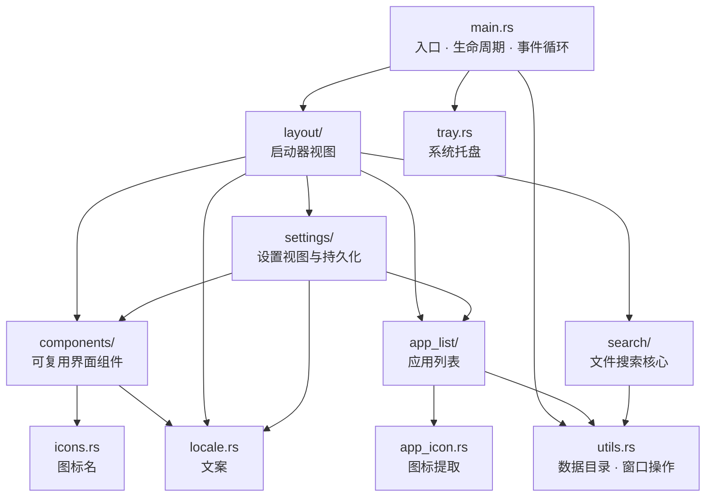
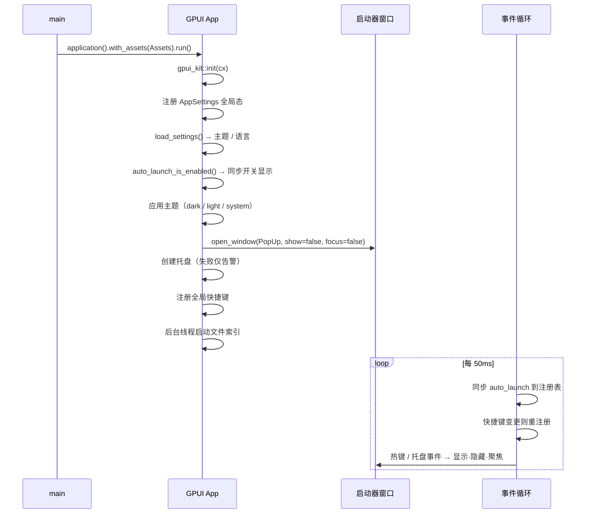
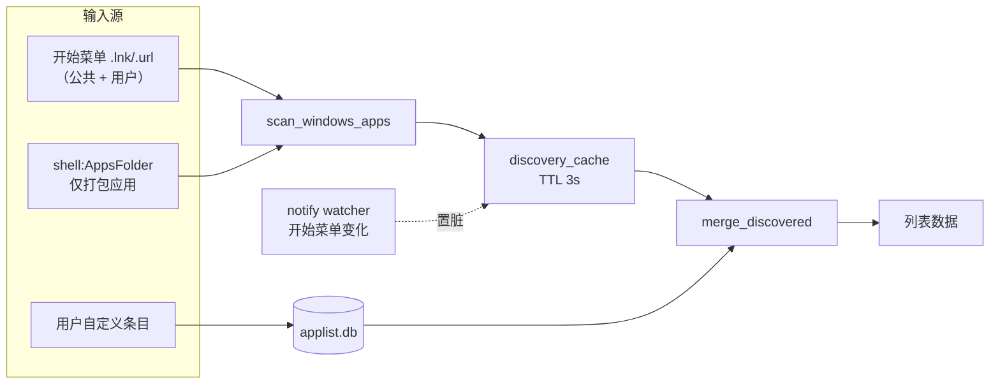

# rastflow 架构文档

> 面向维护者。描述**当前代码的实际结构**与其中的设计取舍，不描述未来计划。
> 文件搜索核心的内部实现另见 [search-engine.md](./search-engine.md)。

## 1. 项目定位

`rastflow` 是常驻系统托盘的 Windows 快速启动器：全局快捷键唤出、搜索并启动本机程序，
可切换到文件搜索模式按文件名搜索全盘文件（索引自建，不依赖 Everything 等外部工具）。

| 项 | 值 |
| --- | --- |
| 语言 / 版本 | Rust，`edition = "2024"` |
| 目标平台 | **仅 Windows**（`#![windows_subsystem = "windows"]`，无控制台窗口） |
| 产物 | 单个 `rastflow.exe` |
| 打包 | `cargo packager` → WiX MSI（`Cargo.toml` 的 `[package.metadata.packager]` + `packaging/rastflow-service.wxs`） |
| 源码规模 | 约 9 800 行（`src/` + `build.rs`，含测试） |

## 2. 技术选型

依赖刻意压得很少，每一项都有明确理由：

| 依赖 | 用途 | 为什么是它 |
| --- | --- | --- |
| `gpui`（`gpui-pre` 0.3） | 渲染与窗口 | 项目基础 |
| `gpui-kit`（`features = ["component"]`） | 样式化组件库 | 统一主题/尺寸/无障碍；只开 `component`，不要 shell |
| `windows` 0.62 | 全部 Win32 调用 | 官方绑定，只开用到的 feature |
| `rusqlite`（`bundled`） | 应用列表存储 | **同步** API，与「取列表」这一同步调用方式一致，省掉异步 runtime；`bundled` 免依赖系统 SQLite |
| `notify` | 监听开始菜单目录 | 新装程序秒级出现在列表 |
| `global-hotkey` | 全局快捷键 | 免自己写 `RegisterHotKey` 的消息泵 |
| `raw-window-handle` | 取 `HWND` | 隐藏/显示窗口、居中需要裸句柄 |
| `rust-embed` | 内嵌 SVG 图标 | 图标随 exe 走，不额外发文件 |
| `image` | 图标位图缩放 | 版本须与 `gpui` 的 `image` 一致 |
| `serde` / `serde_json` | `settings.json` | — |
| `anyhow` | 二进制错误上下文 | 只有 `Assets` 用；核心模块用自定义 `CoreError` |
| `winresource`（build） | exe 图标与版本信息 | 见 §11.4 |

**刻意不引入**：`tray-icon`（连带 `muda`、`dpi` 一棵依赖树，且托盘图标要从自己 exe
的资源段取，直接调 Win32 更短）、`sqlx`/`tokio`（`rusqlite` 已够用）、任何第三方索引服务。

## 3. 模块地图



| 模块 | 职责 | 关键约束 |
| --- | --- | --- |
| `main.rs` | 组装：注册全局状态、开窗口、建托盘、注册热键、跑事件循环 | 托盘与热键**必须在主线程**创建 |
| `components/` | 只画「长什么样」，不持业务状态；数据与回调由调用方注入 | 层次见 §8 |
| `layout/` | 启动器视图（应用列表 + 文件搜索两块） | 渲染路径只查内存 |
| `settings/` | 设置页面、`AppSettings` 全局态、`settings.json` | — |
| `app_list/` | 应用列表：发现、合并、持久化、变更监听 | 落盘在 `rusqlite` 上是同步的 |
| `search/` | 自研文件索引：MFT 建库 + USN 增量 + 匹配 | `unsafe` 只在 `search/win/` |
| `tray.rs` | `Shell_NotifyIconW` + `TrackPopupMenu` | 不抢消息循环 |
| `app_icon.rs` | 从启动目标提取图标并规整成 gpui 位图 | Shell 图标查询必须串行 |
| `utils.rs` | `%LOCALAPPDATA%` 数据目录、隐藏/显示/居中窗口、开机自启 | — |
| `locale.rs` | 中英文案；`t()` 与 `scanning_detail()` | 界面不硬编码中文 |

## 4. 启动与生命周期



**静默启动**：窗口以 `WindowKind::PopUp` + `show: false` + `focus: false` 创建，
不进任务栏、不进 Alt+Tab，等热键或托盘唤出。让「开机自启」不打扰用户是这么来的。

**窗口显隐不用 `minimize`**：`gpui` 的 `minimize_window()` 走 `SW_MINIMIZE`，对 PopUp
窗口会留下一个桌面图标。`utils.rs` 改成直接 `ShowWindow(SW_HIDE / SW_SHOW)`。

## 5. 线程模型

| 线程 | 归属 | 做什么 |
| --- | --- | --- |
| **主线程** | GPUI | 渲染、消息循环、托盘交互、热键事件、事件循环里的状态同步 |
| **GPUI 后台执行器** | `gpui` | 图标提取（Shell/GDI）、文件搜索查询 |
| **索引引导线程** | `layout/filesearch.rs` | 打开快照 → 连索引服务（没有则拉起一次性子进程）→ 起泵线程；只允许一条 |
| **索引泵线程** | `layout/filesearch.rs` | 读管道，把记录/事件落到索引；唯一改索引的地方 |
| **索引服务（独立进程、LocalSystem）** | `search/helper_main.rs` + `win/service.rs` | 常驻 accept；每次会话只做 MFT/USN，不持有索引 |
| **USN 跟随线程（每盘一条，在服务/子进程里）** | `search/monitor.rs` | 阻塞读 USN 日志，按批产出结构化事件 |
| **`notify` 内部线程** | `notify` | 开始菜单目录变更 → 置脏标记 |

**为什么索引要单独的进程**：`CreateFileW(r"\\.\C:")` 请求 `GENERIC_WRITE`，所以
建库与实时跟随都要求管理员。把这件事关进一个小进程后，主程序（常驻托盘、开机自启）
可以一直以普通用户身份跑。索引、快照、搜索都留在主进程，另一边只输出「某个盘上
哪个 FRN 叫什么、父目录是谁」。

这个「小进程」有两种形态，跑同一套管道协议：

1. **Windows 服务**（推荐）——`rastflow.exe --index-service`，`LocalSystem`、自动启动，
   UAC 只在安装那一次；
2. **一次性提权子进程**——`rastflow.exe --index-helper`，用 `runas` 拉起，每次启动都要 UAC。

`unsafe` 因此集中在 `search/win/`：`pipe.rs`（命名管道）、`process.rs`（提权与子进程）、
`service.rs`（SCM 注册/启停/服务主函数）。

**为什么托盘和热键必须在主线程**：两者都依赖 Win32 消息循环。托盘靠向某个窗口投递
自定义消息来通知交互，热键靠 `RegisterHotKey` 把 `WM_HOTKEY` 投到注册线程的消息队列。
`gpui` 的 `spawn` 任务跑在主线程（即拥有消息循环的线程），所以在那里创建是安全的。

**跨线程回 UI 的模式**：后台任务不直接改 UI，而是
`cx.update(|cx| entity.update(cx, …))` 回到主线程改状态再 `cx.notify()`。
用 `WeakEntity` 而非强引用，避免任务比视图活得久时阻止实体销毁。

## 6. 状态管理

三档，按生命周期选择：

| 状态 | 载体 | 例子 |
| --- | --- | --- |
| 应用级、需持久化 | GPUI 全局态 + `settings.json` | 主题、语言、热键、开机自启 |
| 应用级、不需持久化 | GPUI 全局态 | `custom_programs_version`、`last_display` |
| 视图级 | `Entity<T>` | 输入框状态、列表选中项、搜索结果 |
| 进程级共享 | `OnceLock` / `static Mutex` | 索引引擎、SQLite 连接、图标缓存 |

`AppSettings` 变更通过 `cx.observe_global` 触发两件事：写 `settings.json`、
（在主循环里同步 `auto_launch` 到注册表）。

## 7. 数据与持久化

全部落在 `%LOCALAPPDATA%\rastflow\`：

| 文件 | 格式 | 内容 | 由谁写 |
| --- | --- | --- | --- |
| `settings.json` | JSON | 主题、语言 | `settings/persist.rs` |
| `applist.db` | SQLite | 应用列表（`app_entries` 表） | `app_list.rs` |
| `index/index.dat` | 自定义二进制（`RASTIDX1`） | 文件索引快照 | `search/index.rs` |

单文件快照而不是数据库：索引本身常驻内存，快照只是「下次启动免重扫 MFT」的缓存。

**开机自启**不在 `settings.json` 里，唯一事实来源是注册表；启动时读回同步到界面，
避免用户在「任务管理器 → 启动」里关掉后界面仍显示开启。

## 8. 界面层

### 8.1 组件的层次规则

`components/mod.rs` 写明了取舍顺序，也是实际执行的标准：

1. **首选 gpui-kit 的样式化组件**——形态能直接对上就用，不覆盖它的内建样式；
2. **其次 gpui-base 的组合能力**——`h_flex` / `v_flex` / 交互元素等有行为无样式的原语；
3. **最后自绘**——前两层覆盖不到的本项目专有形态。

> ⚠️ **判定标准是「能否直接使用」，不是「库里有没有」。**
> 需要覆盖组件 2~4 个内建样式才能对上设计，就不算直接使用——此时自绘反而更省事、更准。
> 已经踩过并回退的四处：`StatusBar`（自带底色填充与 `px_2`）、
> `Tag`（`xsmall` 用 `rems()` 会算出小数像素字号，中文发虚）、
> `Input::prefix`（内边距过小，图标贴住文字）、
> `Empty`（自带虚线边框，小窗口里过重）。

### 8.2 现有组件

| 组件 | 形态 |
| --- | --- |
| `app_list_item` | 列表行：图标或首字母色块 + 名称 + 12px 类别胶囊 |
| `search_bar` | 模式图标 + `Input` + `Tab` 提示（`Kbd`）或索引标记 |
| `launcher_footer` | 底栏：快捷键提示（纯文本符号）+ 设置按钮 |
| `file_search` | 索引状态面板、结果表头/行（共用列宽常量）、空态 |
| `custom_app_list` | 设置页：`DescriptionList` 展示名称→路径 + 添加按钮 |

公共设施：`ClickHandler`（回调类型别名）、`keystroke()`（静态键位串解析）。

### 8.3 渲染性能约定

启动器列表是虚拟列表，`render_item` **每帧**都会对可见行调用，因此：

- 渲染路径上只允许查内存（图标查 `IconCache`）；
- 真正取图标（Shell/GDI，阻塞且有副作用）在后台分批做（每批 32 个），回填后重绘；
- 取不到也缓存 `None`——失败是结论，不能每帧重试；
- 图标查询用进程级锁串行化：并发调 Shell 图标接口会直接失败
  （`SHGetFileInfoW` 返回 0，`SHGetImageList` 报 `E_OUTOFMEMORY`）。

## 9. 应用列表子系统



要点：

- **每次取列表重新扫描**并与库中条目合并：新装程序自动出现，卸载的自动消失；
  3 秒缓存挡住窗口反复唤出的重复开销。
- **`notify` 让新程序秒级出现**：watcher 只置一个脏标记，UI 侧 500ms 轮询到就
  使缓存失效并重载，不在回调里碰 UI。
- **按名字去重**（不是路径）：VSCode / Clash Party 这类程序在用户与公共开始菜单各有一份
  目标相同的快捷方式，按路径去重会出重影。
- **`shell:AppsFolder` 只收 AppID 含 `!` 的打包应用**：其余是控制面板一类桌面程序，
  开始菜单里本来就有，再收一遍只会得到名称还不一样的重影。
- **身份标识是 `id`**（`name + launch_target` 的哈希），不是名字——用户改名不影响启动计数。
- **写库是同步的**：`rusqlite` 直接在调用线程执行，`INSERT OR REPLACE` 前先开事务；
  内容是「全量写回」，因为列表本身就是全量内存态。写失败只记日志，下次启动再写。

## 10. 文件搜索子系统

概览（细节见 [search-engine.md](./search-engine.md)）：

- **建库**：`FSCTL_ENUM_USN_DATA` 枚举 NTFS 主文件表，不遍历目录树；
- **增量**：每盘一条线程阻塞在 `FSCTL_READ_USN_JOURNAL` 上，事件结构化落到索引；
- **索引常驻内存**，磁盘上只有一份快照；
- **硬链接**：同一 FRN 的多个名字各是一条独立记录（否则另一个名字永远搜不到）；
- **搜索**：优先目录预扫 → 顺序扫索引 → 按后缀优先级分档发布 → 命中时校验存在性并
  顺手摘除失效条目；
- **提权隔离**：枚举与跟随跑在提权子进程/索引服务里，主进程只收管道消息（见 §5）；
- **固有代价**：打开卷句柄请求了 `GENERIC_WRITE`，所以**要么装一次服务，要么每次启动过 UAC**。
  拒绝提权不会把用户挡在门外：已有索引照常可搜，只是拿不到离线补课与实时增量。

## 11. 平台集成

### 11.1 系统托盘

`Shell_NotifyIconW` + `TrackPopupMenu` 直连 Win32。三处必须记住的：

- **必须有窗口**：`Shell_NotifyIcon` 靠向窗口投递自定义消息通知交互，所以先建一个从不显示
  的顶层窗口，用 `GWLP_USERDATA` 挂上下文；
- **不要抢消息循环**：窗口建在 GPUI 主线程上，由 GPUI 的 `GetMessage/DispatchMessage` 派发。
  因此 `WM_DESTROY` 里**绝对不能** `PostQuitMessage`，否则会一并结束 GPUI 的循环；
- **Explorer 重启要重登记**：收到 `TaskbarCreated` 广播后重新注册图标，否则图标永久消失。

托盘图标尺寸取 `SM_CXSMICON`（96 DPI→16、150%→24、200%→32）并夹到 8~64；
写死 16 会让高分屏上的图标被系统放大而发糊。

交互结果通过 channel 交给主循环处理，而不是在窗口过程里直接操作窗口
——窗口过程里拿不到 GPUI 的 `App`/`Context`。托盘不可用时只告警不退出，
因为热键仍能工作。

### 11.2 全局快捷键

`global-hotkey` 管理注册；主循环每 50ms 检查设置是否变化，变了就注销旧的、注册新的。
`parse_hotkey` 把 `"alt+space"` 这类字符串解析成 `HotKey`。

### 11.3 图标提取

两条路径，取决于启动目标是不是 shell 命名空间：

| 目标 | 路径 |
| --- | --- |
| 文件路径（`.exe` / `.lnk` / `.url`） | `SHGetImageList(SHIL_JUMBO)` → `GetIcon` → `GetIconInfo` → `GetDIBits` 读 BGRA |
| `shell:AppsFolder\<AppID>` | `SHCreateItemFromParsingName` → `cast::<IShellItemImageFactory>()` → `GetImage` |

后续处理：裁掉四周全透明区域（小尺寸图标会被 Shell 放进 256 画布一角）、
按预乘 alpha 做盒式滤波缩放到 64px 内。整张全透明视为取不到，回退首字母色块。

### 11.4 构建脚本

`build.rs` 用 `winresource` 把 `assets/app-icon.ico` 与版本信息写进 exe 资源段。
**不能再写自定义清单**——rustc 链接时已内嵌一份默认清单（含 DPI 感知），
再加一份会导致 `CVTRES error CVT1100: 资源重复` 链接失败。

## 12. 关键设计决策

| 决策 | 取舍 |
| --- | --- |
| 自建文件索引而非依赖 Everything | 无外部依赖，安装即用；代价是首次建库需管理员 + 几十秒 |
| 索引常驻内存 + 单文件快照 | 搜索快（顺序扫内存）；快照只是免重扫的缓存，丢失可重建 |
| `rusqlite` 而非 `sqlx`/`tokio` | 同步 API 贴合调用方式，省掉异步 runtime；列表数据量小，同步完全够快 |
| 应用列表全量写回 | 列表本身就是全量内存态，全量写更简单；内容不变则不写 |
| 按名字去重应用条目 | 避免用户/公共开始菜单同名快捷方式产生重影 |
| 视图逻辑与绘制分离 | `delegate.rs` 管数据/选中/启动，`view.rs` 只管组装；delegate 可脱离 GUI 测试 |
| 文案集中在 `locale.rs` | 界面不硬编码中文；跨语言时不必迁就某种语言的排版 |
| 托盘/热键直连 Win32 | 少一棵依赖树；托盘图标与自己 exe 的图标同源 |

## 13. 测试与构建

```bash
cargo check                                    # 无警告
cargo test                                     # 131 通过，5 忽略
cargo clippy --all-targets --all-features      # 剩余告警均在既有非 UI 代码
cargo packager --release                       # 生成 MSI 安装包到 dist/
```

打包链路：`cargo-packager` 自动下载 WiX 3.11 到
`%LOCALAPPDATA%\.cargo-packager\WixTools`（无需手工安装 WiX，但首次需要联网），
由 `main.wxs` 编译主安装包，再链上 `packaging/rastflow-service.wxs` 片段。
片段通过 `FileKey="Path"` 引用主模板里的 `rastflow.exe`，因此不重复打包文件。

MSI 是 **perMachine** 安装，并在 `InstallExecuteSequence` 里插入三个自定义动作：

| 动作 | 时机 | 作用 |
| --- | --- | --- |
| `RollbackIndexService` | `< InstallIndexService` | 安装失败时清掉半装的索引服务 |
| `InstallIndexService` | `After InstallFiles` | `rastflow.exe --install-service`：停旧服务 → 改路径 → 启动 |
| `UninstallIndexService` | `Before RemoveFiles` | `rastflow.exe --uninstall-service`：先停服务，否则进程占着 exe 删不掉 |

三者都是 `Execute="deferred" Impersonate="no"`，以 SYSTEM 运行，安装过程本身不需要再提权。
卸载动作的条件是 `REMOVE~="ALL"`（**没有** `NOT UPGRADINGPRODUCTCODE`）——
主模板的 `RemoveExistingProducts` 排在 `1501`，早于 `InstallFiles`，所以大版本升级时
旧产品必先完整卸载一遍；不在这里停服务的话，服务进程会锁住 exe，覆盖操作会被推迟到重启。

需要真机环境的用例标了 `#[ignore]`，按需手工运行：

```bash
cargo test discovery_smoke -- --ignored --nocapture   # 应用发现
cargo test icon_probe      -- --ignored --nocapture   # 图标提取
```

测试策略：**纯逻辑模块可测**——合并规则、查询解析、路径函数、快照编解码、重采样
都在不驻留 GUI、不接触真实磁盘的前提下覆盖。依赖真实系统状态的（开始菜单、
shell:AppsFolder、本机安装的程序）走 `#[ignore]` 手工冒烟。

## 14. 已知限制

| 限制 | 说明 |
| --- | --- |
| 仅 Windows | 托盘、热键、索引全部依赖 Win32；非 Windows 分支只保证可编译 |
| 服务需要一次管理员安装 | 不装服务也能用，但每次启动都要过 UAC |
| 拒绝提权后无实时增量 | 索引仍可搜索，但不会跟随磁盘变化，也不会补离线变更 |
| 首次建库耗时 | 取决于磁盘文件数，几十秒量级；期间界面显示进度 |
| 托盘图标不随 DPI 变化重建 | 只在启动时算一次尺寸；缩放变化需 `WM_DPICHANGED` 处理（未做） |
| 仅索引本地固定盘 + NTFS | 可移动盘、网络盘、非 NTFS 卷不支持 |
| 索引不含文件大小与修改时间 | 展示时按需 `stat`，避免索引体积膨胀 |
| MSI 卸载不删用户数据 | 配置与索引快照留在 `%LOCALAPPDATA%\rastflow`，重装可继续用 |
